# CTOConnect Site Redesign: Build Instructions

Spec as of Oct 28, 2026. Author: Kyle Miller.

## How to use this folder

- `README.md` (this file) is the spec. Copy in it is final.
- `images/` holds a screenshot of every section at 1440px, plus full-page phone screenshots at 390px. Match them.
- `reference/landing.html` and `reference/about.html` are static HTML renders of the approved designs. Open them in a browser to inspect exact spacing, sizes and colors. They are a visual reference only: do not copy their inline-style markup into the site. Rebuild with Bootstrap 5 and the classes defined below.
- Screenshots and reference files use Inter as the body font. The live site keeps system-ui.

## Overview

Rebuild the ctoconnect.io landing page and About page to match the approved designs. The new pages "show, not tell": real questions, real answers, a marked-up diagram and a career timeline replace the old "You're stuck" copy.

**Keep exactly as is:** the CTOConnect logo SVG, the purple/teal palette, Caveat 700 for headings, the system-ui body font, the nav, the footer, the Articles pages and the Pricing page.

**Change:** the homepage (`index.html`) and the About page, plus one new stylesheet and a set of section includes.

**Copy rules from Kyle (do not drift from these when editing copy):**

- The free 20-minute diagnostic call decides whether we can work together. It is not where Kyle tells the prospect what's wrong.
- No copy that frames Kyle as fixing blow-ups. It reads like he breaks things.
- AI messaging: humans and AI both ship bugs. Do not imply only human-written code is safe.
- No em dashes in site copy.

## Stack and setup

The site is Jekyll 3.10 with Bootstrap 5.3.0 from jsDelivr, served by GitHub Pages behind Cloudflare. Stay inside what GitHub Pages builds natively: no new plugins, no build step, no JS framework.

1. Branch off `main`: `git checkout -b redesign/show-dont-tell`.
2. Run locally with `bundle exec jekyll serve` and work against `localhost:4000`.
3. Create `assets/css/redesign.css` and link it in the default layout after the Bootstrap and Caveat links.
4. Create one include per section under `_includes/home/` and `_includes/about/` (file list in each page section below).
5. Rebuild `index.html` and the About page as front matter plus a list of `` calls.
6. Open a PR with desktop and phone screenshots of both pages. Kyle merges. A push to `main` deploys.

Keep the existing tracking scripts (Fathom, Cloudflare beacon) and Outseta wiring untouched. Do not commit this `docs/redesign/` folder to the published site: add it to `exclude:` in `_config.yml`.

## Design tokens and shared styles

Put these in `redesign.css` as CSS variables and reuse them everywhere. The site already defines `--purple` and `--teal` on `:root`; extend that block.

| Token | Value | Use |
| --- | --- | --- |
| `--purple` | #6b21a8 | Buttons, handwritten notes, accents, final CTA band |
| `--teal` | #14b8a6 | Decorative only: underlines, circles. Fails contrast as text |
| `--teal-text` | #0f766e | Teal text (eyebrows, timeline years) |
| `--ink` | #212529 | Body and headings |
| `--muted` | #495057 | Lead paragraphs |
| `--subtle` | #6c757d | Captions, dates |
| `--band` | #f8f9fa | Alternating section background |
| `--line` | #e5e7eb | Card borders |

**Type:** Caveat 700 for all h1/h2 and the handwritten notes (Caveat 500 for longer notes). Load `Caveat:wght@500;700` instead of the current 700-only link. Body stays system-ui. Headings use `clamp()`: hero h1 `clamp(52px, 6vw, 80px)`, section h2 `clamp(44px, 5.5vw, 72px)`.

**Reusable classes to create:**

- `.btn-pill` / `.btn-pill-outline`: 52px tall, fully rounded, 18px text. Purple fill or 1.5px ink outline.
- `.eyebrow`: 14px, 600 weight, uppercase, 0.08em tracking, `--teal-text`.
- `.note`: Caveat 700, `--purple`, slight rotation (`rotate(-2deg)`). This is the "Kyle's red pen" style used across the page.
- `.squiggle`: the hand-drawn teal underline, an inline SVG path, stroke 4px, round caps. Path: `M3,9 C60,3 140,4 216,7` in a 220×14 viewBox.
- `.card-soft`: white, 1px `--line` border, 14px radius, soft shadow.
- `.section` / `.section-band`: 88 to 96px vertical padding, `clamp(16px, 4vw, 64px)` side padding, max-width 1180 to 1240px.

## Landing page

`index.html` becomes eight includes in this order. Backgrounds alternate white and `--band` as listed.

| # | Include | Background | Replaces |
| --- | --- | --- | --- |
| 1 | `home/hero.html` | White | "You're stuck" hero |
| 2 | `home/answers.html` | Band | "Sound Familiar?" |
| 3 | `home/board.html` | White | "Everyone Is Busy. The Roadmap Still Slips." |
| 4 | `home/markup.html` | Band | "Your Situation Is Specific", "I've Seen These Decisions Blow Up", "What I help with" |
| 5 | `home/timeline.html` | White | Testimonials block |
| 6 | `home/pricing.html` | Band | "How We Can Work Together" (restyle only) |
| 7 | `home/articles.html` | White | "How I Think" |
| 8 | `home/cta.html` | Purple | "Ready to stop winging it?" |

### 1. Hero

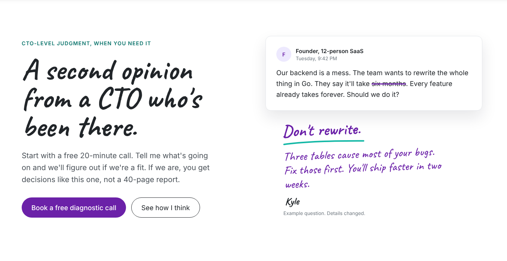

Two columns (stack under 992px). Left: eyebrow, h1, lead, two buttons. Right: a message card from a founder with Kyle's handwritten reply below it.

- Eyebrow: CTO-level judgment, when you need it
- H1: A second opinion from a CTO who's been there.
- Lead: Start with a free 20-minute call. Tell me what's going on and we'll figure out if we're a fit. If we are, you get decisions like this one, not a 40-page report.
- Buttons: **Book a free diagnostic call** (booking link) · **See how I think** (`#answers`)
- Card header: "F" avatar circle, "Founder, 12-person SaaS", "Tuesday, 9:42 PM"
- Card body: Our backend is a mess. The team wants to rewrite the whole thing in Go. They say it'll take ~~six months~~. Every feature already takes forever. Should we do it? ("six months" gets a 3px purple strikethrough)
- Handwritten reply (`.note`): **Don't rewrite.** + teal squiggle, then "Three tables cause most of your bugs. Fix those first. You'll ship faster in two weeks." signed "Kyle"
- Caption, 13px `--subtle`: Example question. Details changed.

### 2. Straight answers (`id="answers"`)

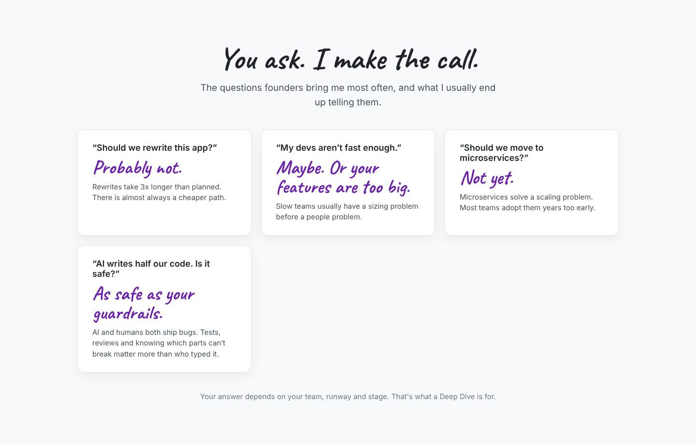

Centered h2 and lead, then a 2x2 grid of `.card-soft` (1 column on phones). Each card: the question in quotes (18px, 600), the answer in Caveat 40px purple, one line of reasoning. Keep the four items in `_data/answers.yml` so Kyle can edit them.

- H2: You ask. I make the call.
- Lead: The questions founders bring me most often, and what I usually end up telling them.

| Question | Answer | Why |
| --- | --- | --- |
| Should we rewrite this app? | Probably not. | Rewrites take 3x longer than planned. There is almost always a cheaper path. |
| My devs aren't fast enough. | Maybe. Or your features are too big. | Slow teams usually have a sizing problem before a people problem. |
| Should we move to microservices? | Not yet. | Microservices solve a scaling problem. Most teams adopt them years too early. |
| AI writes half our code. Is it safe? | As safe as your guardrails. | AI and humans both ship bugs. Tests, reviews and knowing which parts can't break matter more than who typed it. |

- Footer line: Your answer depends on your team, runway and stage. That's what a Deep Dive is for.

### 3. Motion vs. progress board

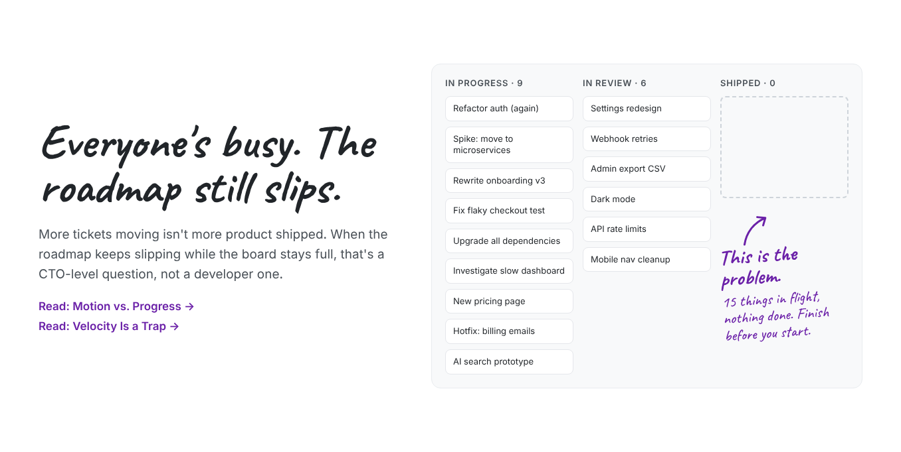

Left: h2, lead, two article links. Right: a fake Kanban board, three columns. It's a static illustration: mark the board `aria-hidden` and give it a visually hidden one-line description.

- H2: Everyone's busy. The roadmap still slips.
- Lead: More tickets moving isn't more product shipped. When the roadmap keeps slipping while the board stays full, that's a CTO-level question, not a developer one.
- Links: Read: Motion vs. Progress → · Read: Velocity Is a Trap → (use the real post URLs)
- Column **In progress · 9**: Refactor auth (again), Spike: move to microservices, Rewrite onboarding v3, Fix flaky checkout test, Upgrade all dependencies, Investigate slow dashboard, New pricing page, Hotfix: billing emails, AI search prototype
- Column **In review · 6**: Settings redesign, Webhook retries, Admin export CSV, Dark mode, API rate limits, Mobile nav cleanup
- Column **Shipped · 0**: an empty dashed box, a hand-drawn purple arrow, then `.note` "This is the problem." and "15 things in flight, nothing done. Finish before you start."
- On phones the three columns may stay side by side with smaller text, or the board can scroll horizontally in its box. No page-level horizontal scroll.

### 4. Marked-up architecture

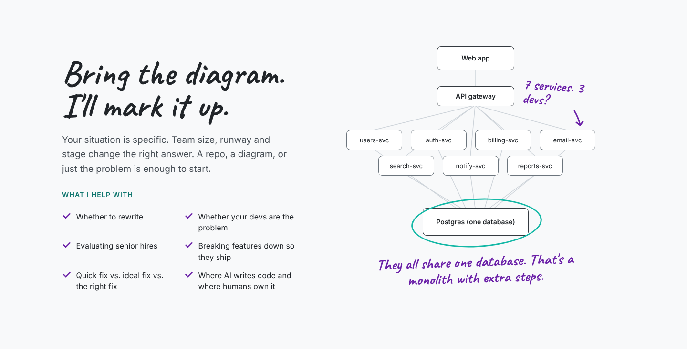

Left: h2, lead, eyebrow, a checklist. Right: a 540×540 diagram built from absolutely positioned boxes plus one SVG for the connector lines. Wrap it in an `overflow-x: auto` box, or scale it with `transform: scale()` under 576px. Exact box positions are in `reference/landing.html`.

- H2: Bring the diagram. I'll mark it up.
- Lead: Your situation is specific. Team size, runway and stage change the right answer. A repo, a diagram, or just the problem is enough to start.
- Eyebrow: What I help with
- Checklist (purple Caveat ✓): Whether to rewrite · Whether your devs are the problem · Evaluating senior hires · Breaking features down so they ship · Quick fix vs. ideal fix vs. the right fix · Where AI writes code and where humans own it
- Diagram: Web app → API gateway → seven service boxes (users-svc, auth-svc, billing-svc, email-svc, search-svc, notify-svc, reports-svc) → one box "Postgres (one database)" circled in teal. Connector lines light gray (#ced4da).
- Notes on the diagram (`.note`): "7 services. 3 devs?" with a small arrow, top right. Under the database: "They all share one database. That's a monolith with extra steps."
- Diagram needs `role="img"` and an `aria-label` that says the same thing as the notes.

### 5. Timeline and testimonials

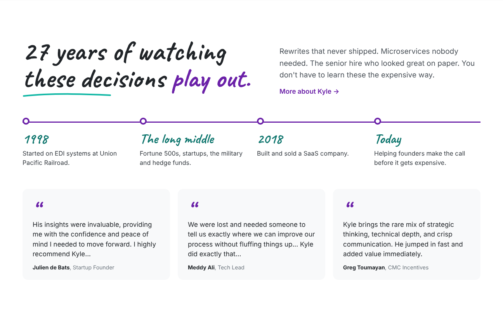

- H2: 27 years of watching these decisions **play out.** ("play out." in purple, teal squiggle under the heading)
- Right of the h2: Rewrites that never shipped. Microservices nobody needed. The senior hire who looked great on paper. You don't have to learn these the expensive way. + link "More about Kyle →" to /about/
- Timeline: a 3px purple top rule with four stops (white dot, 4px purple ring). Year in Caveat 36px `--teal-text`, one line under it. Stops: **1998** Started on EDI systems at Union Pacific Railroad. · **The long middle** Fortune 500s, startups, the military and hedge funds. · **2018** Built and sold a SaaS company. · **Today** Helping founders make the call before it gets expensive.
- Three testimonial cards on `--band`, a big Caveat quote mark, then the existing quotes from Julien de Bats, Meddy Ali and Greg Toumayan, word for word as on the current site.
- Put the timeline stops in `_data/timeline.yml`; the About page reuses them.

### 6. Pricing

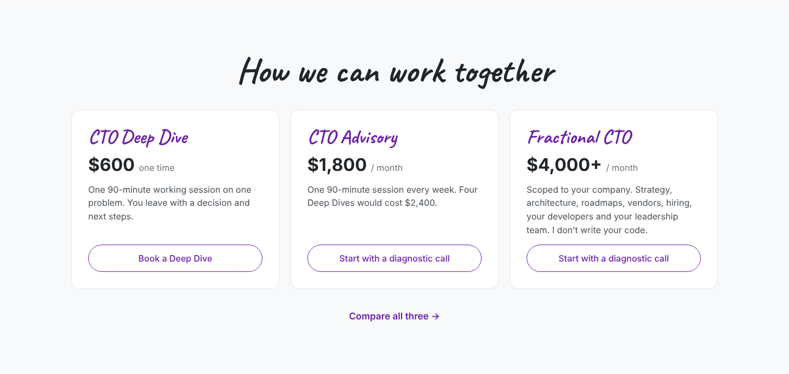

Same three tiers, prices and links as today: CTO Deep Dive $600 one time, CTO Advisory $1,800/month, Fractional CTO $4,000+/month. Restyle as three `.card-soft` cards: tier name in Caveat 36px purple, price 32px bold, description, outline pill button. Keep "Compare all three →" to /pricing/.

### 7. How I think

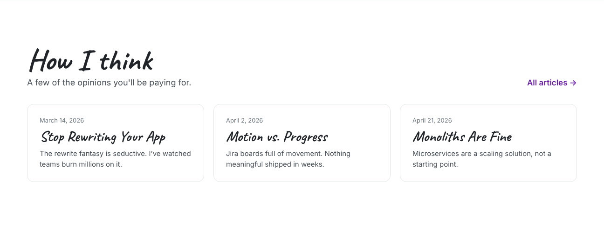

H2 "How I think", sub "A few of the opinions you'll be paying for.", "All articles →" right-aligned. Three cards: date, title in Caveat 32px, excerpt. Pull them from `site.posts` (newest 3, or a `featured: true` front matter flag if Kyle wants to pick them). The design shows Stop Rewriting Your App, Motion vs. Progress and Monoliths Are Fine.

### 8. Final CTA

Full-width purple band, white text, centered.

- H2: Ready to stop winging it?
- Line: 20 minutes. Tell me what's going on. We'll know if we're a fit.
- Button: white pill, purple text, **Book a free diagnostic call**

### Landing page on a phone (390px)

## About page

The About page becomes five includes under `_includes/about/`. Most copy is Kyle's existing About copy, restyled. Set the nav's About link to `aria-current="page"`.

| # | Include | Background | Content |
| --- | --- | --- | --- |
| 1 | `about/hero.html` | White | New header with timeline |
| 2 | `about/worked.html` | Band | Where I've worked |
| 3 | `about/failed.html` | White | What I've seen fail |
| 4 | `about/quick.html` | Band | The quick version + quote |
| 5 | `about/cta.html` | Purple | Closing CTA |

### 1. Header

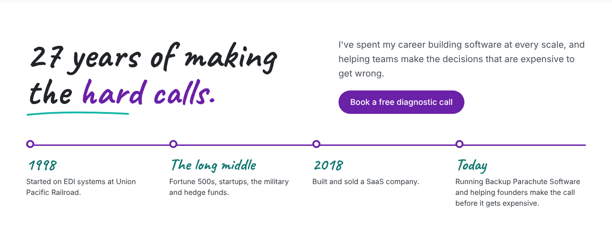

- H1: 27 years of making the **hard calls.** ("hard calls." in purple, teal squiggle under it)
- Lead (right column): I've spent my career building software at every scale, and helping teams make the decisions that are expensive to get wrong.
- Button: Book a free diagnostic call
- Timeline from `_data/timeline.yml`, same component as the homepage. The "Today" stop reads: Running Backup Parachute Software and helping founders make the call before it gets expensive.

### 2. Where I've worked

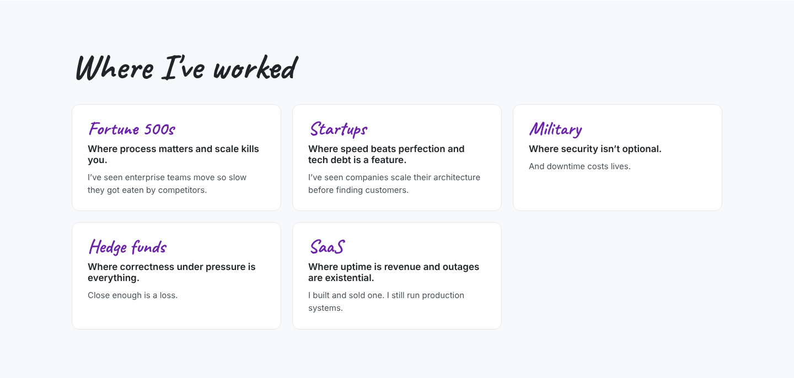

Five `.card-soft` cards in an auto-fit grid. Name in Caveat 34px purple, bold one-liner, then a muted line.

| Name | Bold line | Muted line |
| --- | --- | --- |
| Fortune 500s | Where process matters and scale kills you. | I've seen enterprise teams move so slow they got eaten by competitors. |
| Startups | Where speed beats perfection and tech debt is a feature. | I've seen companies scale their architecture before finding customers. |
| Military | Where security isn't optional. | And downtime costs lives. |
| Hedge funds | Where correctness under pressure is everything. | Close enough is a loss. **(Kyle to confirm, new line)** |
| SaaS | Where uptime is revenue and outages are existential. | I built and sold one. I still run production systems. |

### 3. What I've seen fail

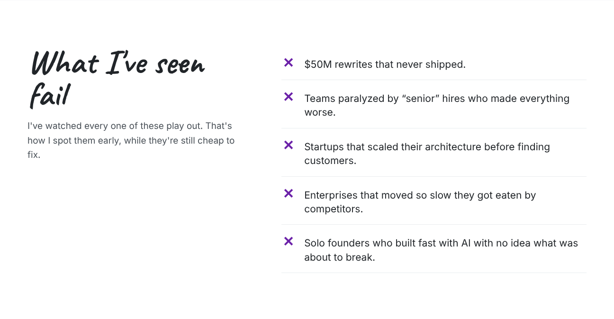

Left: h2 "What I've seen fail" and the lead "I've watched every one of these play out. That's how I spot them early, while they're still cheap to fix." Right: a list, each row a purple Caveat ✗, 21px text and a bottom border:

- $50M rewrites that never shipped.
- Teams paralyzed by "senior" hires who made everything worse.
- Startups that scaled their architecture before finding customers.
- Enterprises that moved so slow they got eaten by competitors.
- Solo founders who built fast with AI with no idea what was about to break.

### 4. The quick version

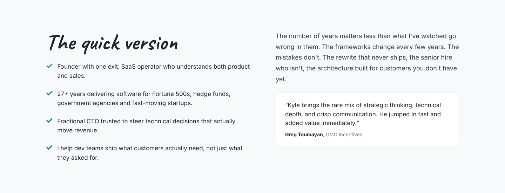

Left: h2 "The quick version" and four teal ✓ lines (Kyle's current Quick Version bullets). Right: the paragraph starting "The number of years matters less than what I've watched go wrong in them" and Greg Toumayan's quote in a white card.

### 5. Closing CTA

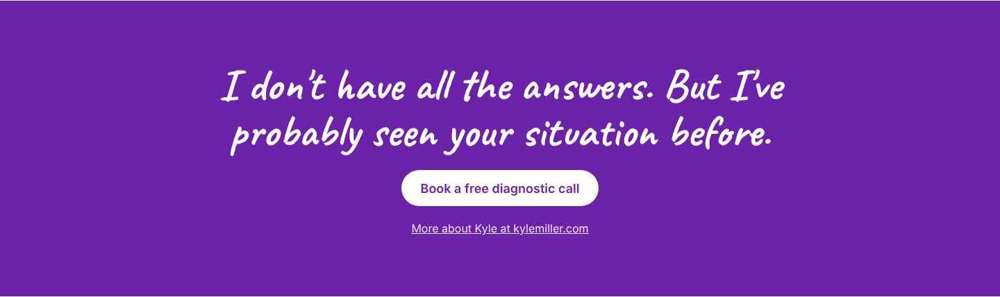

Purple band. H2 "I don't have all the answers. But I've probably seen your situation before." White pill button **Book a free diagnostic call**, then an underlined link "More about Kyle at kylemiller.com".

### About page on a phone (390px)

## Responsive, accessibility and QA

The PR is done when every box below is ticked and Kyle has approved screenshots at 1440px and 390px.

**Responsive**

- [ ] Two-column sections stack under 992px; text column comes first
- [ ] No horizontal page scroll at 390px; diagram and board scroll or scale inside their own box
- [ ] Handwritten notes stay readable on phones (min 24px)
- [ ] Buttons and links are at least 44px tall to tap

**Accessibility**

- [ ] One h1 per page; sections use h2
- [ ] Decorative SVGs (squiggles, arrows, circles) have `aria-hidden="true"`
- [ ] Diagram has `role="img"` and a full `aria-label`; the board has a hidden text description
- [ ] Text contrast 4.5:1 or better: no `--teal` (#14b8a6) text, use `--teal-text`
- [ ] Strikethrough on "six months" is real `<s>` or `<del>`, not an image

**Content and links**

- [ ] Every "Book" button goes to the current booking link
- [ ] Article links and cards point to real posts
- [ ] Testimonials match the current site word for word
- [ ] Copy matches this doc; no em dashes
- [ ] Hedge funds card line confirmed by Kyle

**Regression**

- [ ] Articles, Pricing, Privacy and Terms pages look unchanged
- [ ] Outseta login/subscriber flows still work
- [ ] Fathom still records a pageview on both pages
- [ ] Lighthouse performance and accessibility scores are no lower than the current homepage
